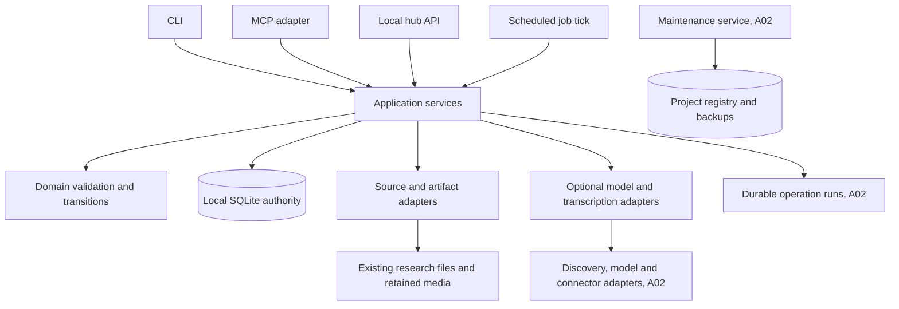

# Architecture and durable storage

## Runtime choices

Python 3.12+ core (pin and actually test the selected minor at CP0), Typer CLI, Pydantic v2 schemas, stdlib sqlite3, pytest/Ruff/mypy. Use uv lockfiles and hatchling packaging. Exact dependency versions and licenses are verified at introduction, not guessed from the designs. No default `--all-extras` install.

At CP3 use the official MCP Python SDK pinned to a tested release. Do not hand-implement protocol negotiation or require a particular unverified future protocol. At CP5 add FastAPI/Uvicorn and TypeScript/React/Vite. Ship built static assets in the wheel; Node is build-time only. Use PDF.js only after checking its exact distribution notices. Optional transcription/provider dependencies are separate extras at CP6. A02 capabilities (CP11–CP16: PDF extraction, local models, discovery adapters, connectors) are further optional extras chosen and verified at their checkpoints; the core install contains no model runtime and needs no account.

A02 adds three architectural rules. First, one operation registry declares every application operation with its schema, authority and capability metadata. The CLI, MCP adapter, local HTTP API and hub are generated from or checked against it, so no transport has an operation or rule the others lack (spec/04 parity). Second, app-owned long work runs as durable operation runs outside write transactions. Third, a small maintenance service inspects, verifies and restores projects through the per-user registry and backup files without opening a project database, so recovery works when a project cannot open.

## Module ownership

| Module | Owns | Boundary |
|---|---|---|
| `domain` | Typed records, transitions, quantity bindings, schemas | No filesystem/network/provider dependencies |
| `store` | Transactions, revisions, payloads, blobs, migrations, backup | No UI or model calls |
| `app` | Use cases, policy enforcement, cross-record validation, receipts | Only shared mutation boundary |
| `sources` | Registration, import, digest observations, safe locators | Reads explicitly allowed roots only |
| `context` / `notebook` | Bounded query plans and rendering | No scientific status mutation |
| `meetings` / `papers` | Reconciliation and deliverable operations | Through app/store interfaces |
| `packages` | Package plans, locks, provenance and host projection | Does not execute third-party scripts |
| `jobs` | Schedule slots and known bounded job handlers | No arbitrary shell jobs |
| `providers` / `audio` | Optional processing | Filtered inputs, cancellable operations |
| `cli` / `mcp` / `hub` | Serialization, transport, presentation | Cannot write store directly |
| `ops` (A02) | Operation registry: schemas, required authority, transports, capability metadata | Declarative; no business logic of its own |
| `runs` (A02) | Durable operation runs, states, resume compatibility, cancellation, budget reservations | Work happens outside write transactions |
| `maintenance` (A02) | Health inspection, backup verification, restore into a new store | Never opens a damaged store for writing |
| `literature` (A02) | Bibliographic import, identifiers, dedup, PDF extraction, evidence matrix, grounding validation | Through app/store interfaces |
| `discovery` / `connectors` (A02) | Public scholarly API adapters; optional external sync | Opt-in egress only; responses are untrusted data; credentials by reference |
| `models` / `routing` (A02) | User-level model registry, provider capability interface, routing policy, usage ledger | One heavy local job at a time; no silent remote fallback |
| `recipes` (A02) | Deliverable rendering from inert templates | Never executes template or package code |
| `events` (A05) | Work-item views, the event outbox written in the same transaction, built-in detectors, the agent-visible queue | Enqueues and reports only; never runs an operation or starts an agent |
| `adoption` (A05) | Inventory, analyzers, fusion, ranking, consolidation plans, baselines and re-adoption of an existing folder | Reads the adoption roots, which are explicitly allowed read-only roots; never writes into them |
| `desktop` (A05) | The desktop shell: window on the loopback hub, sidecar lifecycle, tray, notifications, capture hotkey | A hub client at owner rank; adds no authority; under A07 unchanged until the owner's decision after the trial week |
| `intelligence` (A07) | Typed task registry, the model gateway (the CP6.3 adapter generalised), deterministic validators, the result cache and replay, call receipts, the standing policy, budgets, the evaluation harness, local embeddings | Not an agent: no tools, no loop, no file access beyond the bundle it is given; stores validated proposals only; never sets a status, class, baseline, relation, default, promotion or permission |
| `launcher` (A07) | `start`/`stop`/`status`, the per-home instance lock, the fixed loopback port, the backup before a migration, the PWA manifest and service worker | Its lock is taken by every hub process only; MCP, CLI and workers keep D03's transactional writes; adds no authority |

Create modules only when their checkpoint needs them. Pure domain rules and app operations are shared; adapters do not reproduce them.

Under A05 the desktop application runs as a shell process with the Python core as a loopback sidecar. If the CP19.1 spike chooses a Node-based shell (Electron), Node becomes a runtime dependency of the desktop package only; the core and the hub keep the build-time-only Node rule otherwise, and the choice is recorded with its notices (spec/09).

Under A07 (R40), from CP21 the core is also an application: installed per user with `uv tool install` and run by `prometheos start`, with the hub in the browser, installable as a PWA. One hub process runs per home. The instance lock is an OS-held exclusive lock (a locked file handle or named mutex, released by the OS when the process dies, consistent with the lock rule below); its process id, port and start time are advisory metadata for `status`, never grounds for breaking it. Only hub processes take it. MCP servers, CLI acts and job workers keep D03's transactional multi-process writes under the A04 admission gate. The port is fixed per home so the PWA keeps its origin, and `start` refuses rather than moves when the port is taken. The A05 desktop shell stays as built until the owner decides its future after the trial week. The agent package names the installed tool's interpreter and is regenerated only by the owner's setup command.

## Project storage

Default store is under the user's local application-data directory, keyed by project UUID. The research root contains only an optional `.prometheos-link.json` containing a project ID; no credentials or absolute paths. A per-user registry maps IDs to store locations and allowed research roots. `--store` is supported only for a verified local directory. Refuse known UNC/network/synchronized authority locations; allow an explicit local-path declaration for unknown filesystems while recording that environment limitation. A filesystem probe cannot prove every storage property.

The research folder may itself be a Git checkout or remote source location. Ingestion reads explicit files; no automatic scan of every branch or mounted drive. Source availability and branch coverage remain factual inventory fields.

Store layout: `record.sqlite`, `media/`, `staging/`, `cache/`, `exports/`. Credentials stay in the OS credential store or process environment, never these files. No automatic Git tracking of project records, excerpts or recordings. Under A02, local model assets and the model registry live under the PrometheOS home and are shared by projects. Rebuildable caches such as an embedding index live under the project's `cache/`; they are never authority and backups need not include them.

SQLite settings per connection: `foreign_keys=ON`, `busy_timeout=5000`, `synchronous=FULL`; project creation sets `journal_mode=DELETE`. Read transactions are short; external I/O and model calls occur outside write transactions. `doctor` reports actual Python/SQLite versions, integrity result, path and selected journal. CP0 checks selected runtime release notes/security; do not claim current security from a version string alone.

## Transaction protocol

Tables: `project_state` (schema_version, project_seq), `records` (id, kind, current_rev, sensitivity, lifecycle), `revisions` (id, rev, commit_seq, op_index, recorded_at, occurred_at, body_id, sensitivity, lifecycle), `bodies` (id, encoded JSON), `relations` (source/target/version/relation, created_seq, retired_seq nullable), `audit` (seq, request_id, operation, affected IDs/revisions, actor reference, time), `requests` (unique request_id, canonical hash, committed result), `tasks`, `capabilities`, `job_slots`. FTS5 is a rebuildable derived table in the same database; substring fallback is available when FTS5 is unavailable. Schema SQL and migrations are versioned in code. A02 adds operational tables (operation runs, approval requests, backup inventory, watch state, connector state) and record kinds at their checkpoints; the data spec names them and the migrations they need.

An entity revision is a monotonically increasing integer. Project sequence increments once per committed request, regardless of operation count. Audit rows within a request have deterministic operation positions. Project settings/objective are revisioned with commit_seq too. Historical reads use these sequence intervals and historical sensitivity/lifecycle, with current privacy restrictions still taking precedence. No timestamp decides causality.

Write protocol:

1. Parse/validate request, inspect caller policy and pre-stage bounded content outside the transaction.
2. `BEGIN IMMEDIATE`; look up request_id first. Same canonical request returns original result. Same key/different payload fails. No failed request is saved as committed.
3. Check `expected_seq` and required entity `base_rev` values. Any mismatch returns `revision_conflict`, with no mutation. Reads used for proposals must carry version bindings.
4. Validate cross-record references, source ownership, transitions and capability grants against this transaction's snapshot. Apply the whole ordered batch or none.
5. Save revisions, relationships, derived invalidation flags, audit metadata and idempotent response together. Advance project sequence and commit.
6. Return success only after commit. A crash before commit exposes nothing; a crash after commit but before response is recovered by identical request retry.

Global expected_seq deliberately serializes concurrent proposals. It is simpler than field-level merges. Callers refresh on conflict and regenerate only affected proposals; they must not blindly change the sequence and resubmit a scientific decision. Pure independent creates may be retried after confirming inputs are unchanged.

The database is the authority, not an event replay projection. Revision history supports as-known queries. Exported audit logs are for inspection, not a second recovery engine.

## Payloads and large files

Small excerpts/transcripts/JSON bodies (default up to 8 MiB each) are stored transactionally in `bodies`. Metadata-only audit never duplicates text. Sensitive retained media is copied to a staged file, hashed, flushed, then renamed to its content-addressed destination before its database reference commits. If this fails, the DB mutation fails; unused pre-committed blobs are safe orphans collected after a grace period. Never mark missing bytes retained.

The imported-source policy distinguishes copy-retained versus external-reference-only. Large MAT outputs stay reference-only by default; a checksum cannot recover them. Payload deletion and backup limitations are specified in operations. No blanket promise of tamper-proof history or guaranteed physical erasure.

## Backup, restore and portability

Use SQLite's backup API under a project maintenance lock shared by app operations; include referenced retained media in a manifest with hashes. Block concurrent mutations/purge for the bounded snapshot window. The lock is a real OS-released lock, not PID-file force-unlock logic; test Windows kill recovery. Long backups support cancellation and a clear busy response.

Restore first validates archive paths, schema, all included hashes and DB integrity in a new staging directory. Switch the registry only after success, never overwrite the live store in place. Keep the previous store available until acceptance. Rebind external research roots explicitly; never assume old absolute paths exist. Export/import can create an independent project copy with new project identity and preserved provenance IDs; it is not a merge protocol.

CP1 must test a restored project in a second directory, compare semantic records, revisions and source bindings (CP2 extends this to notebook output), and demonstrate missing reference-only artifacts honestly. Integrity/crash tests run against disposable stores. Document that process-kill tests do not simulate every physical-disk failure.

## Resource budgets

Default import limits: 8 MiB structured request, 200 operations/transaction, 100 selected files/import plan; media handled by a streaming importer with a separately shown limit. Default context 12,000 characters, reserving 2,000 for corrections/coverage; allow 2,000–64,000 with truthful truncation. Lists default 50, max 200, opaque cursor bound to filters and snapshot sequence. No silent whole-project loading.

Suggested responsiveness targets on the recorded Windows test machine: context under 1 s p95 over 1,000 fixture entries, ordinary writes under 500 ms p95 excluding external I/O, hub content update within 2 s. These are acceptance targets to measure, not current claims. Report hardware and dataset; investigate failures before changing thresholds.

Local AI resources (A02, CP12): one heavy local inference job runs at a time, small tasks are batched, and a configurable worker memory ceiling leaves room for the OS, browser, coding agent and scientific software such as MATLAB. Hardware profiles are evaluation targets, not tested minimums: Core (8 GB RAM, modern x64 CPU, SSD, no GPU) for records, hub, lexical search and bibliography; Recommended local AI (16 GB RAM, no GPU) for small embeddings, classifiers, selective OCR and base/small transcription, with a 4 GB worker ceiling as the first experiment; Enhanced (32 GB or a supported GPU) for larger batches and models. Weight-file size is not a RAM requirement. A GPU only accelerates; CPU mode or an honest unavailable state remains. No Docker, WSL, CUDA or separate database is required for local search or transcription. E11 measures the actual figures.
